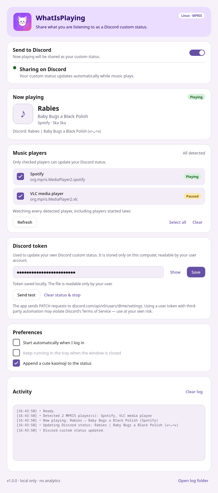

<p align="center">
  
</p>

<h1 align="center">WhatIsPlaying</h1>

<p align="center">
  Turn what you are listening to into a Discord custom status.
</p>

<p align="center">
  Original project by <strong>Martin SVK</strong> · Feature work and polish by
  <strong>DeepSeek V4.1 Flash Free</strong>
</p>

<p align="center">
  
  
  
  
  
  
  
  <a href="https://github.com/Ma-R-aM/What_Is_Playing/releases/latest"></a>
</p>

WhatIsPlaying watches the music player **you choose**, extracts the current
song title and artist, and pushes them to your **Discord custom status**.

There are three builds:

- **Android** — a notification-listener app for phones and tablets.
- **Linux desktop** — a native Qt 6 app for Arch Linux and other distributions.
  It uses **MPRIS over D-Bus**, so it works with Spotify, VLC, Firefox, Rhythmbox,
  Celluloid, KDE Connect and most other Linux media players.
- **Windows desktop** — a native Qt 6 app for **Windows 10 (1809 or newer)** and
  **Windows 11**. It uses the **System Media Transport Controls (SMTC)** API, so
  it works with Spotify, VLC, browsers, MusicBee, foobar2000, TIDAL and other
  players that show up in the Windows media controls.

All builds clean up noisy play-count text, append a random cute kaomoji, and
clear the Discord status when playback is paused.

---

## Features

- 🎵 **Choose your players** — detected players are listed and can be toggled;
  on Linux every MPRIS player, and on Windows every SMTC session, is detected
  automatically.
- 🧹 **Removes play-count suffixes** such as `1,3 tis. prehraní`, `1.3K plays`,
  `12K views`, and similar variants.
- ⏯️ **Clears the status on pause** and restores it when playback continues.
- 🎨 **Appends a random cute kaomoji** to every status (can be turned off on the
  desktop builds).
- 🔑 **Discord token field** — the token is stored locally, readable only by your user.
- 🐱 Custom cat-with-a-music-note icon.
- ✅ Unit tests for the title/artist parser and Discord client.

### Desktop extras (Linux and Windows)

- 🖥️ Native **Qt 6 / PySide6** window with light and dark theme support.
- 🔔 **System tray icon** with show/hide, send toggle, refresh and quit actions.
- 🚀 **Start at login** option (XDG autostart on Linux, the per-user `Run`
  registry key on Windows) and start-minimized-in-tray mode.
- 🧾 **Activity log** in the window and in a rotating log file.
- 🧩 Single-instance handling: launching the app again just raises the window.
- ⌨️ CLI helpers: `--list-players`, `--send-test`, `--clear-status`.

### Linux desktop extras

- 📦 Arch Linux **PKGBUILD** and a no-root per-user installer.

### Windows desktop extras

- 📦 Per-user PowerShell installer with a Start menu shortcut (no administrator
  rights required).

---

## How it works

### Android

1. `WhatIsPlaying` runs as an Android `NotificationListenerService`.
2. It listens for media notifications from the apps selected in the **Music
   apps** card.
3. `TrackInfoParser` cleans the raw title and artist strings.
4. The current playback state is read from the Android media session.
5. `DiscordApi` sends a `PATCH` request to Discord's user settings endpoint.
6. When playback is paused or stopped, the custom status is cleared.

### Linux

1. The app polls **MPRIS** players on the D-Bus session bus every 2 seconds.
2. Each player's `PlaybackStatus` and `Metadata` properties are read.
3. The same track-cleaning rules are applied to the title and artist.
4. When a watched player is playing, the app sends a `PATCH` request to:

   ```text
   PATCH https://discord.com/api/v9/users/@me/settings
   ```

   ```json
   {
     "custom_status": {
       "text": "Song | Artist (=^•ω•^=)",
       "emoji_name": "🌱"
     }
   }
   ```

5. When playback pauses, stops, the player disappears, or sending is turned off,
   the app sends `{"custom_status": null}`.

### Windows

1. The app queries the **Windows.Media.Control** API (`GlobalSystemMediaTransportControlsSessionManager`)
   on a background thread. This API is available on Windows 10 version 1809 and
   newer, and on Windows 11.
2. Every media session's playback status, title, artist and album are read.
   Sessions are grouped by player, so one player is shown once even if it opens
   several sessions. Browser profile AUMIDs are collapsed into a single
   browser entry.
3. The same track-cleaning rules are applied to the title and artist.
4. When a watched session is playing, the app sends the same Discord `PATCH`
   request shown above.
5. When playback pauses, stops, the session closes, or sending is turned off,
   the app clears the custom status.

---

## Requirements

### Android

- Android **7.0 (API 24)** or newer
- Notification access permission
- A Discord account and a Discord **user token**
- Internet connection

### Linux

- Python **3.10+**
- **PySide6** (Qt 6) with the **Qt 6 SVG** module
- **python-dbus** (`python3-dbus` on Debian/Ubuntu) to read MPRIS metadata
- A D-Bus session bus
- A music player that exposes **MPRIS**
- A Discord account and a Discord **user token**
- Internet connection

On Arch Linux install:

```bash
sudo pacman -S --needed python pyside6 qt6-svg python-dbus
```

For a native Wayland session, also install `qt6-wayland` if it is not already
present (KDE Plasma and most desktop environments include it).

### Windows

- **Windows 10 version 1809 (build 17763)** or newer, or Windows 11
- Python **3.10+** (64-bit recommended)
- **PySide6** (Qt 6) with the Qt 6 SVG module
- The **PyWinRT** projections for `Windows.Media.Control` and its supporting
  namespaces (installed by the requirements file)
- A Discord account and a Discord **user token**
- Internet connection

Install the Python dependencies with:

```powershell
python -m pip install -r packaging/windows/requirements-windows.txt
```

> Windows 10 builds older than 1809 do not provide the media-session API used by
> the app. Windows 7, 8 and 8.1 are not supported.

---

## Android: getting started

> **Prebuilt APK:** download the latest `WhatIsPlaying-*.apk` from the
> [Releases page](https://github.com/Ma-R-aM/What_Is_Playing/releases/latest)
> and install it. You may need to allow installation from unknown sources.

### 1. Build the app

```bash
git clone <your-repository-url>
cd WhatIsPlaying
./gradlew :app:assembleDebug
```

The debug APK will be created at:

```text
app/build/outputs/apk/debug/app-debug.apk
```

You can also open the project in Android Studio and run it on your phone.

### 2. Install and open the app

Install the APK, then open **WhatIsPlaying**.

### 3. Grant notification access

In the app, tap **Open notification access** and allow WhatIsPlaying to read
notifications.

This is required because the app needs to see the media notification posted by
your music player.

### 4. Choose your music apps

In the **Music apps** card, tick the players that should update your Discord
status. Detected players appear automatically with their icons.

If your player is missing, tap **Browse all** and search for it in the full list
of installed apps.

### 5. Add your Discord token

Paste your Discord user token into the **Discord token** field and tap
**Save token**.

The token is stored locally in the app's private SharedPreferences and is
excluded from Android backups.

### 6. Enable sending

Turn on **Send to Discord**.

Play a song in one of the selected apps. Your Discord custom status should update
automatically.

---

## Linux: getting started

<p align="center">
  
</p>

### 1. Run directly from this checkout

```bash
sudo pacman -S --needed python pyside6 qt6-svg
./packaging/run-source.sh
```

No notification access is needed on Linux. The app detects MPRIS players as soon
as they start.

### 2. Install for your user (no root)

```bash
./packaging/install-user.sh
```

This installs:

```text
~/.local/bin/whatisplaying
~/.local/lib/whatisplaying/
~/.local/share/applications/whatisplaying.desktop
~/.local/share/icons/hicolor/scalable/apps/whatisplaying.svg
```

Launch **WhatIsPlaying** from your application menu, or run:

```bash
~/.local/bin/whatisplaying
```

To remove the user installation later:

```bash
./packaging/uninstall-user.sh
```

### 3. Build and install an Arch package

```bash
./packaging/arch/build-package.sh
sudo pacman -U packaging/arch/whatisplaying-1.0.0-1-any.pkg.tar.zst
```

Or build and install in one step:

```bash
./packaging/arch/build-package.sh --install
```

The package depends on `python`, `pyside6` and `python-dbus`, installs the
desktop entry and icon, and puts the launcher in `/usr/bin/whatisplaying`.

Remove it with:

```bash
sudo pacman -R whatisplaying
```

### 4. Add your Discord token

Open the app, paste your Discord user token into the **Discord token** field and
press **Save**. Use **Send test** to verify the token.

The token is saved in:

```text
~/.config/whatisplaying/config.json
```

The file is written with mode `600`, so only your user account can read it.
**Do not put this file in a Git repository or share it.**

### 5. Start sharing

Make sure **Send to Discord** is on, start a song in Spotify, VLC, Firefox or
another MPRIS player, and the status updates automatically.

The **Music players** card shows every detected player. Tick only the ones that
should be allowed to change your status. **Select all** watches every current
and future player.

### 6. Optional extras

- **Start automatically when I log in** writes an XDG autostart entry at
  `~/.config/autostart/whatisplaying.desktop`.
- **Keep running in the tray when the window is closed** hides the window instead
  of quitting. Use the tray menu to show the window again or quit.
- The app starts in the tray when launched with `--minimized`.

### Command-line helpers

```bash
whatisplaying --version
whatisplaying --list-players
whatisplaying --send-test
whatisplaying --clear-status
whatisplaying --minimized
whatisplaying --no-tray
```

- `--list-players` prints detected media players, their keys and current tracks.
- `--send-test` and `--clear-status` use the saved token and exit.
- `--minimized` starts hidden in the tray when a tray is available.
- `--no-tray` disables the tray icon entirely.

Logs are written to:

```text
~/.local/state/whatisplaying/whatisplaying.log
```

---

## Windows: getting started

### 1. Run directly from this checkout

Install Python 3.10 or newer, then from the repository root:

```powershell
python -m pip install -r packaging/windows/requirements-windows.txt
.\packaging\windows\run-source.ps1
```

`run-source.cmd` does the same thing for Command Prompt users:

```bat
packaging\windows\run-source.cmd
```

If PowerShell refuses to run the script, use
`powershell -ExecutionPolicy Bypass -File .\packaging\windows\run-source.ps1`.

No notification access is needed on Windows. The app detects media sessions as
soon as a player starts reporting to the Windows media controls.

### 2. Install for your user (no administrator rights)

```powershell
powershell -ExecutionPolicy Bypass -File .\packaging\windows\install-user.ps1
```

This creates a private virtual environment and installs:

```text
%LOCALAPPDATA%\WhatIsPlaying\app\
%LOCALAPPDATA%\WhatIsPlaying\venv\
%LOCALAPPDATA%\Programs\WhatIsPlaying\whatisplaying.cmd
%APPDATA%\Microsoft\Windows\Start Menu\Programs\WhatIsPlaying.lnk
```

Launch **WhatIsPlaying** from the Start menu, or run:

```bat
%LOCALAPPDATA%\Programs\WhatIsPlaying\whatisplaying.cmd
```

To remove the installation later (quit the app first so its files are not in
use):

```powershell
powershell -ExecutionPolicy Bypass -File .\packaging\windows\uninstall-user.ps1
```

Your settings and Discord token are kept when uninstalling.

### 3. Add your Discord token

Open the app, paste your Discord user token into the **Discord token** field and
press **Save**. Use **Send test** to verify the token.

The token is saved in:

```text
%APPDATA%\whatisplaying\config.json
```

Windows protects this folder with your user profile's access control list. Only
your Windows account can read it by default. **Do not put this file in a Git
repository or share it.**

### 4. Start sharing

Make sure **Send to Discord** is on, start a song in Spotify, VLC, a browser, or
another player that appears in the Windows media controls, and the status updates
automatically.

The **Music players** card shows every detected media session. Tick only the
ones that should be allowed to change your status. **Select all** watches every
current and future player.

### 5. Optional extras

- **Start automatically when I log in** adds the per-user Run registry value
  `HKCU\Software\Microsoft\Windows\CurrentVersion\Run\WhatIsPlaying`, which
  points at `%LOCALAPPDATA%\WhatIsPlaying\autostart.cmd`.
- **Keep running in the tray when the window is closed** hides the window
  instead of quitting. Use the tray menu to show the window again or quit.
- The app starts in the tray when launched with `--minimized`.

### Command-line helpers

```powershell
.\packaging\windows\run-source.ps1 --version
.\packaging\windows\run-source.ps1 --list-players
.\packaging\windows\run-source.ps1 --send-test
.\packaging\windows\run-source.ps1 --clear-status
.\packaging\windows\run-source.ps1 --minimized
.\packaging\windows\run-source.ps1 --no-tray
```

After `install-user.ps1`, use `%LOCALAPPDATA%\Programs\WhatIsPlaying\whatisplaying.cmd`
instead of the script path. Add that folder to `PATH` if you want to type
`whatisplaying` from any terminal.

- `--list-players` prints detected media sessions, their keys and current tracks.
- `--send-test` and `--clear-status` use the saved token and exit.
- `--minimized` starts hidden in the tray when a tray is available.
- `--no-tray` disables the tray icon entirely.

Logs are written to:

```text
%LOCALAPPDATA%\whatisplaying\whatisplaying.log
```

---

## Play-count cleanup examples

| Raw notification artist | Cleaned artist |
| --- | --- |
| `IamOutlandish a 1,3 tis. prehraní` | `IamOutlandish` |
| `IamOutlandish, 1,3 tis. prehraní` | `IamOutlandish` |
| `IamOutlandish • 1,3 tis. prehraní` | `IamOutlandish` |
| `Artist, 1.3K plays` | `Artist` |
| `Artist, 12K views` | `Artist` |
| `Artist One, Artist Two a 1,3 tis. prehraní` | `Artist One, Artist Two` |

To add another wording, edit the regex in:

```text
app/src/main/java/martin_svk/whatisplaying/TrackInfoParser.kt      # Android
desktop/whatisplaying/parser.py                                    # Linux + Windows
```

and add matching tests in:

```text
app/src/test/java/martin_svk/whatisplaying/TrackInfoParserTest.kt  # Android
desktop/tests/test_parser.py                                       # Linux + Windows
```

The parser only removes a play-count phrase when it appears at the **end** of the
artist string, so normal artist names containing numbers are left alone.

---

## Pause / resume behaviour

### Android

The app reads the playback state from the media session:

- **Playing** → Discord status is shown.
- **Paused / stopped** → Discord status is removed.
- **Playing again** → Discord status is restored.

A lightweight watcher checks the playback state every 5 seconds, so this also
works if the music app does not update its notification when paused.

> Pause detection depends on the music app exposing a media session.
> Most players do this. If an app does not, pause detection may not work
> reliably.

### Linux

The app polls `PlaybackStatus` from MPRIS every 2 seconds:

- **Playing** → the current track is sent.
- **Paused / stopped / player closed** → the status is cleared.
- **Playing again** → the status is sent again.

### Windows

The app polls the playback status from SMTC every 2 seconds:

- **Playing** → the current track is sent.
- **Paused / stopped / session closed** → the status is cleared.
- **Playing again** → the status is sent again.

> Pause detection depends on the player reporting its status to the Windows
> media controls. Most modern players do this; a few only publish metadata.

---

## Customisation

### Add another music app

- **Android:** open **Music apps**, then **Browse all** and tick the player.
- **Linux:** start the player and tick it in **Music players**. MPRIS support is
  provided by the player itself; no per-app configuration is needed.
- **Windows:** start the player and tick it in **Music players**. SMTC support is
  provided by the player itself; no per-app configuration is needed.

### Add more kaomojis

Edit the `KAOMOJIS` list:

```kotlin
// app/src/main/java/martin_svk/whatisplaying/WhatIsPlaying.kt
private val KAOMOJIS = listOf(
    "(=^•ω•^=)",
    "(=^･ω･^=)",
    "(ฅ^•ﻌ•^ฅ)",
    // add more here
)
```

```python
# desktop/whatisplaying/parser.py
KAOMOJIS = (
    "(=^•ω•^=)",
    "(=^･ω･^=)",
    "(ฅ^•ﻌ•^ฅ)",
    # add more here
)
```

### Change the status format

The Android status string is built in `buildStatus()` in `WhatIsPlaying.kt`:

```kotlin
"$title | $artist $kaomoji"
```

The Linux and Windows versions use `build_status()` in
`desktop/whatisplaying/parser.py`.

---

## Project structure

```text
app/src/main/java/martin_svk/whatisplaying/     # Android app
├── MainActivity.kt          # Compose settings screen + music app picker
├── MusicAppScanner.kt       # Finds installed music players and their icons
├── WhatIsPlaying.kt         # Notification listener + Discord status logic
├── TrackInfoParser.kt       # Title/artist cleaning and play-count regex
├── DiscordApi.kt            # Discord HTTP requests
├── AppPreferences.kt        # Saved toggle, selected apps, Discord token
└── ui/theme/                # Compose theme

app/src/test/java/martin_svk/whatisplaying/
└── TrackInfoParserTest.kt   # Android parser unit tests

desktop/whatisplaying/       # Linux + Windows desktop app (Qt 6 / PySide6)
├── app.py                   # Entry point, CLI, single-instance handling
├── controller.py            # Media session → parser → Discord coordination
├── media.py                 # Platform-neutral snapshot + backend selection
├── mpris.py                 # Linux: MPRIS players + metadata over D-Bus
├── smtc.py                  # Windows: SMTC media sessions (PyWinRT)
├── parser.py                # Title/artist cleaning, status builder
├── discord.py               # Discord HTTP client
├── config.py                # Platform config paths and token storage
├── autostart.py             # Picks the Linux or Windows autostart backend
├── autostart_linux.py       # XDG autostart entry
├── autostart_windows.py     # HKCU Run registry entry
├── icons.py                 # SVG icon rendering
├── assets/                  # App icon and checkbox SVGs
└── ui/                      # Main window, widgets and theme

desktop/tests/               # Linux/Windows unit + worker integration tests

packaging/
├── install-user.sh          # Linux: no-root install into ~/.local
├── uninstall-user.sh
├── run-source.sh            # Linux: run from this checkout
├── linux/                   # Launcher and .desktop template
├── arch/                    # PKGBUILD + build-package.sh
└── windows/                 # Requirements, run and install PowerShell scripts
```

---

## Tests

### Android

Run the parser tests:

```bash
./gradlew :app:testDebugUnitTest
```

Build the debug APK:

```bash
./gradlew :app:assembleDebug
```

Run Android lint:

```bash
./gradlew :app:lintDebug
```

### Linux

```bash
PYTHONPATH=desktop python3 -m unittest discover -s desktop/tests -v
```

### Windows

```powershell
$env:PYTHONPATH = "desktop"
python -m unittest discover -s desktop/tests -v
```

This covers the parser, config permissions, Discord request payloads and error
handling, retry behaviour, autostart files/registry entries, the SMTC session
reader, and the controller/worker round trip against a local HTTP server.

Quick checks:

```bash
PYTHONPATH=desktop python3 -m compileall -q desktop/whatisplaying
./packaging/run-source.sh --version
./packaging/run-source.sh --list-players
```

On Windows:

```powershell
.\packaging\windows\run-source.ps1 --version
.\packaging\windows\run-source.ps1 --list-players
```

---

## Troubleshooting

### Discord status is not updating

- Make sure **Send to Discord** is turned on.
- Make sure the player is ticked in **Music players**.
- Make sure a valid Discord token has been saved and **Send test** works.
- On Android, make sure notification access is granted.
- On Android, check Logcat with the tag `MusicApp`:

  ```bash
  adb logcat -s MusicApp
  ```

- On Linux, check the in-app **Activity** log or:

  ```bash
  tail -f ~/.local/state/whatisplaying/whatisplaying.log
  ```

  If the log mentions that `python-dbus` is not installed, the player can be
  detected but its title and artist cannot be read, so the status is never sent.
  Install `python-dbus` (`python3-dbus` on Debian/Ubuntu) and restart the app.

- On Windows, check the in-app **Activity** log or:

  ```powershell
  Get-Content "$env:LOCALAPPDATA\whatisplaying\whatisplaying.log" -Wait
  ```

### Discord returns `401 Unauthorized`

The token is invalid, expired, or was copied incorrectly. Paste it again in the
app.

### Play count is still visible

Add the exact wording to the regex in `TrackInfoParser.kt` (Android) or
`parser.py` (Linux and Windows), and add a test case.

### My music app is not in the list

- **Android:** tap **Browse all** in the **Music apps** card and search for it by
  name or package. Some players do not advertise a media-button receiver or media
  browser service, so they cannot be detected automatically, but they can still
  be selected manually.
- **Linux:** the player must expose MPRIS. Verify with:

  ```bash
  busctl --user list | grep mpris
  # or, if playerctl is installed:
  playerctl -l
  ```

  Browsers expose MPRIS when a tab is actually playing media. If no MPRIS service
  appears, the player cannot be used by this app.
- **Windows:** the player must report to the Windows media controls (SMTC). Start
  playback and open the volume flyout; if the player appears there, it should also
  appear in **Music players**. Players that only publish a notification without
  using SMTC cannot be detected.

### Linux starts but no players are detected

- Check that you are in a graphical session with a D-Bus session bus:

  ```bash
  echo "$DBUS_SESSION_BUS_ADDRESS"
  ```

- Start playback first, then press **Refresh**.
- Some players register MPRIS only after the first track starts.

### Windows starts but no players are detected

- Start playback first, then press **Refresh**.
- Open the Windows volume/media flyout and confirm the player is shown there.
- If the app reports that Windows media controls are unavailable, install the
  PyWinRT dependency:

  ```powershell
  python -m pip install -r packaging\windows\requirements-windows.txt
  ```

- Make sure you are on Windows 10 version 1809 or newer.
- Check the log file for `Windows media error` lines.

### Status does not clear when paused

- On Android, the music app may not be exposing a media session.
- On Linux, the player must update `PlaybackStatus` to `Paused` or `Stopped` over
  MPRIS. If it keeps reporting `Playing`, the status stays visible.
- On Windows, the player must report `Paused` or `Stopped` through SMTC. A few
  players keep reporting `Playing` while paused, in which case the status stays
  visible.

### Linux tray icon is missing

The tray requires a StatusNotifier host. KDE Plasma provides one; GNOME needs an
extension such as AppIndicator. Without a tray, the window does not hide on close
and the autostart option launches it normally.

### Windows tray icon is missing

Make sure the notification area is not hiding the icon. Open **Settings → Taskbar
→ Other system tray icons** (or the equivalent on your Windows version) and turn
WhatIsPlaying on. Without a tray, the window does not hide on close and the
autostart option launches it normally.

### The desktop app is already running

Launching the app again raises the existing window instead of starting a second
copy. To quit, use the window's **Quit** shortcut (`Ctrl+Q`) or the tray menu.

---

## Privacy

- No analytics.
- No third-party server.
- The app talks directly to Discord's API.
- The selected players are stored only on the device.
- **Android:** `QUERY_ALL_PACKAGES` is requested solely to show the list of
  installed apps in the picker. It does not read app data or send the list
  anywhere. The Discord token is stored in private SharedPreferences and excluded
  from Android backup and device transfer.
- **Linux:** the Discord token is stored in
  `~/.config/whatisplaying/config.json` with mode `0600`. No player list or token
  is sent anywhere except Discord.
- **Windows:** the Discord token is stored in
  `%APPDATA%\whatisplaying\config.json`, protected by your user profile's access
  control list. No player list or token is sent anywhere except Discord.
- Logs never contain the Discord token.

---

## ⚠️ Discord token warning

This app uses a **Discord user token** to update your own custom status.

- Never commit your token to Git.
- Never share your token with anyone.
- Using a user token with third-party clients or automation may violate
  Discord's Terms of Service. Use at your own risk.
- If you believe your token has leaked, revoke it / log out of all sessions in
  Discord immediately.

---

## Credits

- Original project idea and initial vibe-coded implementation: **Martin SVK**
- Feature implementation, refactoring, parser tests, music app picker, app icon,
  Linux desktop port, Windows desktop port, Arch packaging and README:
  **DeepSeek V4.1 Flash Free** running in **OpenCode**
- Built with Kotlin, Jetpack Compose, Material 3, Python, PySide6, Qt 6 and
  PyWinRT

Not affiliated with Discord, Metrolist, Deezer, Spotify, Apple Music, or any
other music player.
