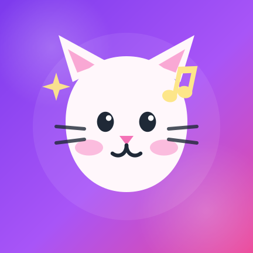

<p align="center">
  
</p>

<h1 align="center">WhatIsPlaying</h1>

<p align="center">
  Turn your Metrolist or Deezer notification into a Discord custom status.
</p>

<p align="center">
  Original project by <strong>Martin SVK</strong> · Feature work and polish by
  <strong>DeepSeek V4.1 Flash Free</strong>
</p>

<p align="center">
  
  
  
  
</p>

WhatIsPlaying is a small Android notification-listener app that watches media
notifications from **Metrolist** and **Deezer**, extracts the current song title
and artist, and pushes them to your **Discord custom status**.

It also cleans up the play-count text that Metrolist sometimes adds to the
artist name, adds a random cute kaomoji, and clears the Discord status when
playback is paused.

---

## Features

- 🎵 Works with **Metrolist** (`com.metrolist.music`) and **Deezer**
  (`deezer.android.app`).
- 🧹 Removes play-count/views suffixes from artist names, for example
  `1,3 tis. prehraní`, `1.3K plays`, `12K views`, and similar variants.
- ⏯️ Clears the Discord status when playback is paused and restores it when
  playback continues.
- 🎨 Appends a random cute/cat/femboy kaomoji to every status.
- 🔘 Simple settings screen with a **Send to Discord** on/off switch.
- 🔑 Discord token can be entered directly in the app.
- 🐱 Custom cat-with-a-music-note app icon.
- ✅ Unit tests for the title/artist parser.

---

## How it works

1. `WhatIsPlaying` runs as an Android `NotificationListenerService`.
2. It listens for media notifications from Metrolist and Deezer.
3. `TrackInfoParser` cleans the raw title and artist strings.
4. The current playback state is read from the Android media session.
5. `DiscordApi` sends a `PATCH` request to Discord's user settings endpoint:

   ```text
   PATCH https://discord.com/api/v9/users/@me/settings
   ```

6. When playback is paused or stopped, the custom status is cleared.

---

## Requirements

- Android **7.0 (API 24)** or newer
- Notification access permission
- A Discord account and a Discord **user token**
- Internet connection

---

## Getting started

### 1. Build the app

```bash
git clone <your-repository-url>
cd WhatIsPlaying
./gradlew :app:assembleDebug
```

The debug APK will be created at:

```text
app/build/outputs/apk/debug/app-debug.apk
```

You can also open the project in Android Studio and run it on your phone.

### 2. Install and open the app

Install the APK, then open **WhatIsPlaying**.

### 3. Grant notification access

In the app, tap **Open notification access** and allow WhatIsPlaying to read
notifications.

This is required because the app needs to see the media notification posted by
Metrolist/Deezer.

### 4. Add your Discord token

Paste your Discord user token into the **Discord token** field and tap
**Save token**.

The token is stored locally in the app's private SharedPreferences and is
excluded from Android backups.

### 5. Enable sending

Turn on **Send to Discord**.

Play a song in Metrolist or Deezer. Your Discord custom status should update
automatically.

---

## Play-count cleanup examples

| Raw notification artist | Cleaned artist |
| --- | --- |
| `IamOutlandish a 1,3 tis. prehraní` | `IamOutlandish` |
| `IamOutlandish, 1,3 tis. prehraní` | `IamOutlandish` |
| `IamOutlandish • 1,3 tis. prehraní` | `IamOutlandish` |
| `Artist, 1.3K plays` | `Artist` |
| `Artist, 12K views` | `Artist` |
| `Artist One, Artist Two a 1,3 tis. prehraní` | `Artist One, Artist Two` |

If your music app uses another wording, add it to the regex in:

```text
app/src/main/java/martin_svk/whatisplaying/TrackInfoParser.kt
```

and add a matching test in:

```text
app/src/test/java/martin_svk/whatisplaying/TrackInfoParserTest.kt
```

---

## Pause / resume behaviour

The app reads the playback state from the media session:

- **Playing** → Discord status is shown.
- **Paused / stopped** → Discord status is removed.
- **Playing again** → Discord status is restored.

A lightweight watcher checks the playback state every 5 seconds, so this also
works if the music app does not update its notification when paused.

> Pause detection depends on the music app exposing a media session.
> Metrolist and Deezer do this. If another app does not, pause detection may not
> work reliably.

---

## Customisation

### Add another music app

Edit the package list in `WhatIsPlaying.kt`:

```kotlin
private val MUSIC_PACKAGES = setOf(
    "com.metrolist.music",
    "deezer.android.app",
    // add another package here
)
```

### Add more kaomojis

Edit the `KAOMOJIS` list in `WhatIsPlaying.kt`:

```kotlin
private val KAOMOJIS = listOf(
    "(=^•ω•^=)",
    "(=^･ω･^=)",
    "(ฅ^•ﻌ•^ฅ)",
    // add more here
)
```

### Change the status format

The status string is built in `buildStatus()` in `WhatIsPlaying.kt`:

```kotlin
"$title | $artist $kaomoji"
```

---

## Project structure

```text
app/src/main/java/martin_svk/whatisplaying/
├── MainActivity.kt          # Compose settings screen
├── WhatIsPlaying.kt         # Notification listener + Discord status logic
├── TrackInfoParser.kt       # Title/artist cleaning and play-count regex
├── DiscordApi.kt            # Discord HTTP requests
├── AppPreferences.kt        # Saved toggle + Discord token
└── ui/theme/                # Compose theme

app/src/main/res/
├── drawable/                # Adaptive icon vectors
├── mipmap-*/                # Legacy and round launcher icons
└── values/                  # App name, theme, colours

app/src/test/java/martin_svk/whatisplaying/
└── TrackInfoParserTest.kt   # Parser unit tests
```

---

## Tests

Run the parser tests:

```bash
./gradlew :app:testDebugUnitTest
```

Build the debug APK:

```bash
./gradlew :app:assembleDebug
```

Run Android lint:

```bash
./gradlew :app:lintDebug
```

---

## Troubleshooting

### Discord status is not updating

- Make sure notification access is granted.
- Make sure **Send to Discord** is turned on.
- Make sure a valid Discord token has been saved.
- Check Logcat with the tag `MusicApp`:

  ```bash
  adb logcat -s MusicApp
  ```

### Discord returns `401 Unauthorized`

The token is invalid, expired, or was copied incorrectly. Paste it again in the
app.

### Play count is still visible

Add the exact wording to the regex in `TrackInfoParser.kt` and add a test case.
The parser only removes a play-count phrase when it appears at the **end** of the
artist string, so normal artist names containing numbers are left alone.

### Status does not clear when paused

The music app may not be exposing a media session, or the notification may not
contain a media session token. Metrolist and Deezer are supported.

---

## Privacy

- No analytics.
- No third-party server.
- The app talks directly to Discord's API.
- The Discord token is stored only on the device.
- The token preference is excluded from Android backup and device transfer.

---

## ⚠️ Discord token warning

This app uses a **Discord user token** to update your own custom status.

- Never commit your token to Git.
- Never share your token with anyone.
- Using a user token with third-party clients or automation may violate
  Discord's Terms of Service. Use at your own risk.
- If you believe your token has leaked, revoke it / log out of all sessions in
  Discord immediately.

---

## Credits

- Original project idea and initial vibe-coded implementation: **Martin SVK**
- Feature implementation, refactoring, parser tests, app icon, and README:
  **DeepSeek V4.1 Flash Free** running in **OpenCode**
- Built with Kotlin, Jetpack Compose, and Material 3

Not affiliated with Discord, Metrolist, or Deezer.
